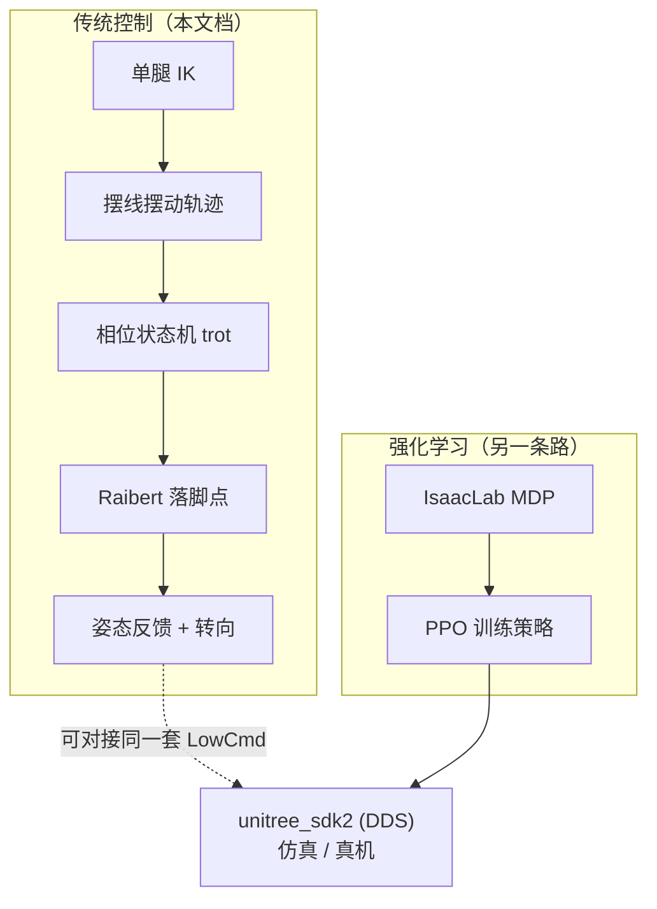

# Go2 传统步态控制（MuJoCo 版）

> 目标：不依赖 Isaac Sim / ROS2 / 强化学习，用 **`python + mujoco`** 亲手实现一遍
> 「站立 → 逆运动学 → 摆动轨迹 → trot → 速度跟踪 → 平衡与转向」，
> 把腿式机器人控制的基本功打牢。
>
> 配套：`GO2_GUIDE.md`（RL 训练与部署）、`GO2_TRAINING_METRICS.md`（RL 训练曲线判读）
> 代码目录：仓库根目录下的 `classical_gait/`（6 个阶段脚本 + 2 个公共模块）

---

## 0. 这条路线是什么，和 RL 什么关系



两条路线**平行**：

| | 传统控制 | 强化学习 |
|---|---|---|
| 行为来源 | 人写的相位、轨迹、反馈律 | 神经网络从奖励中自己学 |
| 优点 | 可解释、可证明、参数少、调试直观 | 复杂地形/扰动下上限高、开发周期短 |
| 缺点 | 复杂地形需要大量手工设计 | 需要仿真、调奖励、难解释 |
| 算力 | CPU 即可，MuJoCo 500 Hz 实时 | 训练需要 GPU 集群（本机 8 GB 可跑小规模） |

先做传统控制，你会真正理解“为什么四足能走”；之后看 RL 的策略时，就能判断它到底在干什么。

---

## 0.5 · 预备知识（零基础先看）

如果上面这些词你还有点虚，先花 5 分钟看这一节。**看不懂公式没关系，先建立直觉。**

| 概念 | 一句话解释 | 在 Go2 上的具体对应 |
|---|---|---|
| **自由度 DOF** | 一个能独立运动的“旋钮” | 12 个关节 = 12 个旋钮；加上机身浮动（位置 3 + 姿态 3）= 18 个自由度 |
| **关节角 $q$** | 电机转了多少弧度 | `hip` 绕 x 轴侧摆；`thigh`/`calf` 绕 y 轴摆动 |
| **力矩 $\tau$** | “拧”关节的力 | MJCF 里是 `<motor>`，`ctrl` 就是力矩（N·m） |
| **PD 控制** | 用“弹簧 + 阻尼”把关节拉到目标角 | $\tau = k_p(q_{des}-q) - k_d\dot q$，本项目全部控制都建立在它之上 |
| **逆运动学 IK** | 想让脚到某点，关节该转多少 | 给定足端 (x,y,z) → 反解 3 个关节角 |
| **步态相位 $\varphi$** | 一个周期里的“进度条”，0→1 循环 | trot 周期 0.5 s，$\varphi<0.6$ 支撑、否则摆动 |
| **占空比 duty** | 一条腿有多少时间踩在地上 | 0.6 = 60% 支撑 / 40% 摆动 |
| **trot（对角小跑）** | 对角两腿同时动 | FL+RR 一组、FR+RL 一组，相位差 0.5 |
| **支撑相 / 摆动相** | 脚踩地 / 脚在空中 | 支撑相负责推进，摆动相负责“换脚” |
| **落脚点** | 脚下一次踩在哪里 | 踩得靠前走得快、踩得靠后能刹车（Raibert） |
| **roll / pitch / yaw** | 横滚（左右歪）/ 俯仰（低头抬头）/ 偏航（转向） | 三个角都是 0 = 机身完全水平且朝正前方 |
| **打滑 slip** | 脚说踩住了，实际在地上蹭 | 这是开环 trot 比指令慢的主因 |
| **支撑多边形** | 四只脚围成的区域 | 重心投影落在里面才站得稳；trot 时只有两个对角脚，所以需要动态平衡 |

**三句话建立整体图景**

1. 我们控制的不是“机器人的位置”，而是 **12 个关节的目标角度**（50 Hz 下发）；
2. 关节角通过 IK 对应到 **4 个足端位置**，足端位置随时间按**相位 + 摆线**运动；
3. 足端相对机身向后划 → 地面反作用力把机身推向前 → **“走”就这么发生了**。

---

## 1. 快速开始

### 环境

```bash
conda activate env_isaaclab      # 或 mujoco_env，两者都装了 mujoco>=3.14
cd ~/unitree_rl_lab_egg/classical_gait
```

脚本只需 `numpy` + `mujoco`，不依赖 Isaac Lab / rsl-rl / DDS。

### 六个阶段

```bash
python 01_stand.py                 # 站立
python 02_leg_ik.py                # 逆运动学数值验证
python 03_swing_trajectory.py      # 单腿摆动（机身吊住）
python 04_trot_openloop.py         # 开环 trot
python 05_raibert_walk.py          # Raibert 速度跟踪
python 06_balance_turn.py --wz 0.4 # 姿态反馈 + 转向
```

想看得见就加 `--viewer`（需要图形界面）：

```bash
python 06_balance_turn.py --vx 0.3 --wz 0.4 --viewer --realtime
```

### 代码结构

```
classical_gait/
├── go2_model.py           # 模型常量、FK/IK、PD、状态读取、诊断
├── gait.py                # 相位调度 + 摆线轨迹 + 落脚点规划（控制器核心）
├── 01_stand.py            # 阶段1
├── 02_leg_ik.py           # 阶段2
├── 03_swing_trajectory.py # 阶段3
├── 04_trot_openloop.py    # 阶段4
├── 05_raibert_walk.py     # 阶段5
└── 06_balance_turn.py     # 阶段6
```

---

## 2. 模型与坐标系

### 2.1 参数（全部来自 `~/unitree_mujoco/unitree_robots/go2/go2.xml`）

| 符号 | 含义 | 数值 |
|---|---|---|
| $L_1$ | 大腿长（侧摆轴 → 膝） | 0.213 m |
| $L_2$ | 小腿长（膝 → 足心） | 0.213 m |
| $d$ | 腿平面相对侧摆电机的 y 偏移 | 0.0955 m |
| — | 髋关节 x 偏移（前/后） | ±0.1934 m |
| — | 髋关节 y 偏移（左/右） | ±0.0465 m |
| $r_f$ | 足端球半径 | 0.022 m |
| — | 每腿关节 | `hip`(绕 x, ±60°)、`thigh`(绕 y, −90°~200°)、`calf`(**负角**, −156°~−48°) |
| — | 执行器 | `<motor>` 力矩控制，hip/thigh ±23.7 N·m，knee ±45.43 N·m |
| — | 关节阻尼 / 电枢 | 0.1 / 0.01 |

坐标系：**x 前、y 左、z 上**，原点在机体几何中心（`base_link`）。

### 2.2 站姿几何

home 关节角 $[0,\ 0.9,\ -1.8]$（单位 rad），髋到足心距离：

$$
h_{\text{leg}} = 2L_1\cos(0.9) = 2\times0.213\times0.6216 \approx 0.2647\ \text{m}
$$

加上足半径，正确站立高度为

$$
h_{\text{base}} = 0.2647 + 0.022 \approx 0.2868\ \text{m}
$$

> ⚠️ MJCF 的 keyframe 用的是 `z=0.27`，这会让足端球陷入地面约 17 mm。教程里统一用
> `HOME_HEIGHT = 0.2868`（见 `go2_model.py`）。

### 2.3 两个必须注意的顺序问题

| 项 | 顺序 |
|---|---|
| **关节 qpos 顺序** | `FL_hip, FL_thigh, FL_calf, FR_…, RL_…, RR_…`（按 body 声明顺序） |
| **actuator 顺序** | `FR_hip, FR_thigh, FR_calf, FL_…, RR_…, RL_…`（**和上面不同**） |
| 本仓库 deploy 的 `joint_sdk_names` | `FR, FL, RR, RL`（与 actuator 一致） |

`go2_model.py` 通过**关节名反查 actuator 编号**，并把所有对外接口统一成
`LEGS = (FL, FR, RL, RR)` 顺序，避免这类错位。

---

## 3. 数学基础

### 3.1 单腿正运动学（FK）

设侧摆角 $q_1$、大腿角 $q_2$、膝角 $q_3$，腿平面内（x–z 平面）足端坐标：

$$
x_p = -L_1\sin q_2 - L_2\sin(q_2+q_3),\qquad
z_p = -L_1\cos q_2 - L_2\cos(q_2+q_3)
$$

侧摆绕 $x$ 轴旋转，加上大腿关节的横向偏移 $y_{p0}=s\,d$（$s=+1$ 左腿，$-1$ 右腿）：

$$
\begin{bmatrix}x\\y\\z\end{bmatrix}
=
\begin{bmatrix}
x_p\\
c_1\,y_{p0} - s_1\,z_p\\
s_1\,y_{p0} + c_1\,z_p
\end{bmatrix},
\quad c_1=\cos q_1,\ s_1=\sin q_1
$$

### 3.2 单腿逆运动学（IK）——最容易写错的地方

**第一步：解侧摆角。** 由于 $y+iz = e^{iq_1}(y_{p0}+iz_p)$，且 $z_p=-r<0$：

$$
m=\sqrt{y^2+z^2},\qquad r=\sqrt{m^2-d^2}
$$

$$
q_1=\operatorname{atan2}(z,\ y)-\operatorname{atan2}(-r,\ s\,d)
$$

> 这里有两个常见错误：
> 1. 写成 `atan2(y, z)`（相当于用 $z+iy$ 的相位），会得到 $-q_1$ 的符号错误；
> 2. 忽略 $-r$ 的负号，把足端当成在髋上方。
>
> 本仓库第一次实现时就踩了第 1 个坑：往返误差 5.75 rad。

**第二步：腿平面两连杆 IK。** 令 $D=\sqrt{x^2+r^2}$ 并裁剪到 $[\,|L_1-L_2|,\ L_1+L_2\,]$：

$$
q_3=-\arccos\!\left(\frac{D^2-L_1^2-L_2^2}{2L_1L_2}\right)
\quad(\text{取负解，Go2 的膝就是负向弯})
$$

$$
\beta=\arccos\!\left(\frac{L_1^2+D^2-L_2^2}{2L_1D}\right),\qquad
\delta=\operatorname{atan2}(x,\ r),\qquad
q_2=\beta-\delta
$$

**工作空间**：这套解析解默认足端在髋下方（$z<0$）。整条关节限位包含“腿折叠到髋上方”的姿态，
那不属于我们的目标区间。`02_leg_ik.py` 的往返测试因此只在 $q_2\in[0.2,1.5]$、$q_3\in[-2.6,-1.0]$ 内采样。

### 3.3 摆动相轨迹（摆线）

从离地点 $p_0$ 到落地点 $p_1$，$u\in[0,1]$：

$$
x(u)=x_0+(x_1-x_0)\left(u-\frac{\sin 2\pi u}{2\pi}\right),\qquad
z(u)=z_0+h\frac{1-\cos 2\pi u}{2}
$$

优点：两端水平速度为 0（落地不冲击、离地不打滑），中间速度最大（快速通过）。
$z$ 曲线是 $\sin^2$ 形状，抬到 $h$ 后再落回，端点高度/速度为 0。

### 3.4 相位与 trot

$$
\varphi_{\text{leg}}(t)=\left(\frac{t}{T}+\varphi^{0}_{\text{leg}}\right)\bmod 1,\qquad
\varphi^0:\ \text{FL}=\text{RR}=0,\ \ \text{FR}=\text{RL}=0.5
$$

对角腿同相，形成 trot。$\varphi<\text{duty}$ 为支撑相（duty=0.6 → 60% 时间支撑），否则摆动相。

### 3.5 支撑相为什么能把机身推走

在**机体系**里给足端目标，支撑相让它以 $-v_{\text{cmd}}$ 的速度后移：

$$
p_{\text{stance}}(u)=p_{\text{nom}}-v_{\text{point}}\,T_{\text{st}}\left(u-\tfrac12\right),\qquad T_{\text{st}}=\text{duty}\cdot T
$$

足端实际被地面“粘住”，于是机身被迫以 $v_{\text{cmd}}$ 前进。一个步态周期机身前进
$v_{\text{cmd}}\cdot T$。

转弯时足端的机体速度要用刚体公式：

$$
v_{\text{point}}=(v_x-\omega_z y_{\text{nom}},\ \ v_y+\omega_z x_{\text{nom}})
$$

外侧腿行程更长，机身自然转向。

### 3.6 Raibert 落脚点

开环只按指令速度排布步长，实际速度会因打滑/PD 跟随误差而偏低。加一项速度反馈：

$$
\Delta x = k\,(v_{\text{meas}}-v_{\text{cmd}})
$$

当前速度低于指令 → $\Delta x<0$ → 落脚点整体后移 → 支撑腿向前推 → 加速。
符号很容易写反，实测：$k=0.4$ 时速度从 0.20 m/s 提到 0.32 m/s（指令 0.4）。

### 3.7 姿态反馈

腿是“支撑杆”：**加长某条腿会把机身该侧顶高**。因此

$$
z_{\text{target}} \mathrel{+}= k_{\text{roll}}\cdot\text{roll}\cdot s_{\text{side}}
\;-\; k_{\text{pitch}}\cdot\text{pitch}\cdot s_{\text{front}}
$$

* `roll > 0` 表示左侧抬高（$R_x$ 正转），要缩短左腿 → 左腿 z 目标抬高（符号 `+`）
* `pitch > 0` 表示低头（$R_y$ 正转，机头向下），要**加长**前腿把机头顶起来 → 前腿 z 目标降低（符号 `−`）

> 这里也踩过坑：最初写成 `+k_pitch*pitch`，结果机身越走越低头（pitch 到 −0.44 rad）；
> 改成负号后倾角降到 0.02~0.05 rad。

### 3.8 偏航角速度反馈

和 Raibert 对线速度做的事一样，对偏航角速度也做一层误差放大：

$$
\omega_{\text{eff}} = \omega_{\text{cmd}} + k_{\omega}\cdot(\omega_{\text{cmd}} - \omega_{\text{meas}})
$$

用 $\omega_{\text{eff}}$ 代替 $\omega_{\text{cmd}}$ 去算足端速度 $v_{\text{point}}$，左右腿的行程差就会变大，
从而产生更强的偏航力矩。工程上还有两个必要细节：

1. **低通滤波**：对角小跑的 yaw 角速度天然带 2 Hz 的抖动，直接乘增益会把抖动放大成
   横向摆动。所以先把 $\omega_{\text{meas}}$ 做一阶低通（`wz_alpha=0.05`）。
2. **指令门限**：直行时（$\omega_{\text{cmd}}=0$）不需要这层反馈，否则噪声会被放大、
   前进速度反而下降。所以增益按 $|\omega_{\text{cmd}}|$ 渐变（`wz_gate=0.2`）。

**实测效果**（$v_x=0.3$，8 s）：

| 配置 | 偏航角速度（指令 0.4） | 最大倾角 |
|---|---|---|
| 无反馈 | 0.163 rad/s | 0.055 rad |
| $k_\omega=2$，无滤波 | 0.313 rad/s（**但直行会变差**） | 0.048~0.165 rad |
| $k_\omega=2$，带滤波 + 门限 | **0.306 rad/s** | 0.053 rad |
| $k_\omega=3$ | 摔倒 | — |

---

## 4. 六个阶段详解

### 阶段 1 · 站立：`01_stand.py`

**目的**：验证模型加载、关节顺序、PD 增益、站姿高度。

**做法**：12 个关节用 PD 力矩打到 home 姿态，500 Hz 控制。

**参数**（`go2_model.py`）：

```python
KP_STAND = [80, 120, 120]   # hip, thigh, calf
KD_STAND = [5, 2, 2]
```

**实测**：高度 0.2787 m（理论 0.2868，**静态下垂 8.1 mm**），倾角 0.003 rad，四足着地。

**为什么下垂**：PD 是比例控制，重力矩需要稳态误差来提供力矩。8 mm 由
$L\cdot\Delta q$ 换算约 0.03 rad 的角度误差。想消除它有三种办法（文档里都值得知道）：
加大 $k_p$、加积分项、加重力前馈（$ \tau_{ff} = $ 逆动力学）。

**调参**：下垂过多 → 加 $k_p$；抖动/啸叫 → 加 $k_d$；身体前后倾斜 → 检查
`HOME_LEG` 是否与模型的 home 一致。

---

### 阶段 2 · 逆运动学：`02_leg_ik.py`

**目的**：把 3.1/3.2 的公式变成可验证的代码，不跑物理。

**做法**：
1. 2000 组随机关节角 → FK → IK → 与原始角对比；
2. 足端画半径 5 cm 的圆 → IK → FK → 与目标点对比。

**实测**：往返误差 `1.3e-15 rad`，笛卡尔误差 `0.0000 mm`。

**调参/排错**：
* 误差大且恒定 → 侧摆公式或 $d$ 的符号错（典型：误差恰好 $2d=0.191$ m）
* 某些点误差突然变大 → 接近腿长极限或膝角越限（`D` 被裁剪）

---

### 阶段 3 · 单腿摆动：`03_swing_trajectory.py`

**目的**：单独验证摆线轨迹 + IK 跟随，排除平衡问题。

**做法**：每一步把机体的 6 个自由度重置回固定高度（相当于吊带），只让一条腿摆。

**实测**：抬腿峰值 5.8 cm（指令 6.0），足心最低 0.0220 m（恰好等于足半径，不穿地）。

**注意**：$k_d$ 对跟踪精度影响很大：

| $k_d$（thigh/calf） | 抬腿峰值 |
|---|---|
| 5 | 4.7 cm |
| 3 | 5.4 cm |
| **2** | **5.8 cm** |
| 1 | 6.2 cm（开始有过冲） |

$k_d$ 太大 → 摆动相阻尼“吃掉”速度，抬腿不足；太小 → 落地反弹。**2 是这台模型上的折中**。

---

### 阶段 4 · 开环 trot：`04_trot_openloop.py`

**目的**：证明“相位 + 摆线 + IK + PD”就能让 Go2 走起来。

**做法**：对角腿同相，支撑相足端后移，无任何反馈。

**实测**（6 s，指令 0.3 m/s）：前进 1.162 m，平均 0.202 m/s（指令的 67%），不摔。

**为什么慢**：足端打滑 + PD 跟随误差，导致“脚相对机身后退”的速度小于设定值。
这正是阶段 5 要修的。

**调参**：
* 走不动/原地踏步 → 检查步长 $vT$ 是否过小，或 duty 太大（支撑相太长）
* 摔跤 → 降低 $v_x$、抬高 `swing_height`、加大 duty（更稳）或减小周期

---

### 阶段 5 · Raibert 速度跟踪：`05_raibert_walk.py`

**目的**：用落脚点反馈把实际速度拉到指令。

**实测**（8 s，指令 0.4 m/s，$k=0.4$）：0.318 m/s，误差 0.082 m/s。

$k$ 的扫描结果（指令 0.4）：

| $k$ | 平均速度 |
|---|---|
| 0.08 | 0.242 |
| 0.2 | 0.256 |
| **0.4** | **0.286 → 0.318（$k_d$ 调整后）** |
| 0.8 | 0.288（饱和） |

**要点**：$k$ 有饱和上限，因为加速度受摩擦/力矩限制。继续加大只会让落脚点摆幅变大而不加速。

---

### 阶段 6 · 姿态反馈 + 转向：`06_balance_turn.py`

**目的**：在走的基础上保持机身水平，并跟踪偏航指令。

**做法**：3.7 的 roll/pitch 补偿 + 3.5 的 $\omega_z$ 项 + 3.8 的偏航反馈。

**实测**（8 s，$v_x=0.3$，$\omega_z=0.4$，$k_\omega=2.0$）：

| 指标 | 结果 |
|---|---|
| 最大倾角 | 0.053 rad（目标 <0.15） |
| 平均前进速度 | 0.153 m/s（指令 0.3） |
| 平均偏航角速度 | 0.306 rad/s（指令 0.4，误差 23%） |
| 是否摔倒 | 否 |

反向指令 $\omega_z=-0.4$：偏航 −0.291 rad/s、倾角 0.052 rad；直行 $\omega_z=0$：偏航仅 −0.004 rad/s。

**说明**：

* 偏航跟踪依赖**足端横向打滑**，本就比线速度难做；0.4 rad/s 指令能跟到约 75%，
  小指令（如 0.2 rad/s）反而更难——接近打滑阈值，力矩不足以产生净偏航；
* 方向必须对：如果实测偏航与指令反号，先查 $\omega_z$ 项符号（$v_y+\omega_z x$）；
* 再往上就是 **MPC/WBC** 了：它们显式地优化地面反力，而不是靠“猜”打滑。

---

## 5. 参数整定手册

按这个顺序调，每次只改一个：

| 顺序 | 参数 | 位置 | 症状 → 调整 |
|---|---|---|---|
| 1 | `KP_STAND` / `KD_STAND` | `go2_model.py` | 站不住/下垂 → 加 $k_p$；抖 → 加 $k_d$；抬腿不够 → 减小腿 $k_d$ |
| 2 | `body_height` (`LEG_EXT`) | `gait.py` | 机身太高走不稳/太低蹭地 |
| 3 | `period` | `gait.py` | 0.4~0.6 s；太小 → 来不及跟踪，太大 → 每步冲击大 |
| 4 | `duty` | `gait.py` | 0.55~0.65；越大越稳越慢；<0.5 会出现腾空相 |
| 5 | `swing_height` | `gait.py` | 0.04~0.08 m；太小会拖地，太大落地冲击 |
| 6 | `raibert_k` | 脚本参数 | 速度跟不上 → 加到 0.3~0.5；前后窜动 → 减小 |
| 7 | `k_roll` / `k_pitch` | 脚本参数 | 机身歪 → 0.1~0.3；高频摇摆 → 减小 |
| 8 | `k_yaw` / `wz_alpha` / `wz_gate` | 脚本参数 + `gait.py` | 转向跟不上 → 加 $k_\omega$（1~2）；横向摇摆 → 减小 $k_\omega$ 或加大滤波；直行变慢 → 检查门限 |

**常见症状速查**

| 症状 | 可能原因 |
|---|---|
| 原地踏步 | 步长 $vT$ 太小；$v_x$ 设成 0 |
| 走几步就摔 | 抬腿不足（蹭地）、duty 太小、$k_d$ 太大 |
| 越走越低头/抬头 | `k_pitch` 符号或大小；重心偏移 |
| 速度上不去 | 打滑；`raibert_k` 太小；关节力矩到限幅 |
| 转向跟不上 | `k_yaw` 太小；或指令接近打滑阈值（小角速度更难） |
| 转向时左右摇 | `k_yaw` 太大 / 未滤波；减小 `k_yaw` 或 `wz_alpha` |
| 直行比之前慢 | `k_yaw` 在直行时仍生效（检查 `wz_gate`） |
| 左右摇摆 | 步态不对称（检查左右腿 IK 的 $s\,d$ 符号）；`k_roll` 太小 |
| 转向方向反了 | $\omega_z$ 项的符号（$v_y+\omega_z x$） |

---

## 6. 踩过的坑（本仓库真实记录）

1. **actuator 顺序 ≠ 关节顺序**：MJCF 里 actuator 是 FR/FL/RR/RL，qpos 是 FL/FR/RL/RR；
   用 `mj_name2id` + `actuator_trnid` 反查最稳。
2. **膝角是负的**：`calf` 限位 `[-2.72, -0.84]`，IK 必须取负解，否则一上来就撞限位。
3. **侧摆 IK 的相位写法**：`atan2(y,z)` 会得到反号；正确是 `atan2(z,y) - atan2(-r, s·d)`。
4. **keyframe 高度 0.27 会让脚陷进地面 17 mm**，正确高度 0.2868。
5. **`scene.xml` 里有障碍物**（x=1.2 m 起的方块），代码里只关闭 worldbody 的 box 碰撞，保留地面。
6. **pitch 补偿符号**：写反会让机身越走越低头。
7. **Raibert 符号**：`k(v_meas − v_cmd)`，不是 `k(v_cmd − v_meas)`。
8. **PD 静态下垂**：所有“高度/抬腿”验收阈值都要留出 5~10 mm 的余量，别按理论值卡。
9. **偏航反馈必须先滤波**：trot 的 yaw 角速度每步都在 ±0.1 rad/s 量级抖动，
   直接乘 $k_\omega=2$ 会把抖动放大成横向摆动（直行时倾角从 0.055 升到 0.165 rad）。
10. **偏航反馈要加指令门限**：直行时不需要它，否则前进速度从 0.14 降到 0.065 m/s。
    `wz_gate` 让增益随 $|\omega_{\text{cmd}}|$ 渐变后就恢复正常。

---

## 7. 与 RL 路线对照，以及下一步

| 你现在掌握的 | 对应的 RL 概念 |
|---|---|
| 相位状态机 | 策略输出（隐式学到步态） |
| 摆线摆动相 | 动作（关节目标）时序 |
| Raibert 落脚点 | 奖励里的速度跟踪 + 网络学到的落脚策略 |
| 姿态反馈 | 观测里的 projected gravity + 学到的平衡 |
| 关节 PD | IsaacLab 的 `ImplicitActuator`（stiffness/damping） |

**继续深入的三条路**

1. **接下来一周做什么**
   * 把 `06_balance_turn.py` 的 $\omega_z$ 反馈再调一轮（试 `wz_alpha`、`wz_gate`），
     目标是让 $\omega_z=0.2$ 也能跟上；
   * 给 `TrotParams` 加一个“步态枚举”（trot / pace / bound），比较三种步态的稳定性；
   * 加**斜坡地形**（`scene_terrain.xml` 或自己搭几块斜面）：只用现有控制器就会暴露
     姿态反馈的局限；
   * 加 **IMU 噪声 / 通信延迟 / 关节限幅**，让仿真更接近真机。

2. **接仿真器 / 真机（把“算法”变成“系统”）**
   * 用 `unitree_sdk2_python` 收发 `LowCmd` / `LowState`，把控制器接到 `unitree_mujoco`
     （本机已装），这与 `deploy/` 里 RL 策略用的通信层完全一致；
   * 关注三件事：**控制周期**（真机 2 ms / 500 Hz）、**延迟补偿**、**失稳保护**
     （倾角超限切 Passive）；
   * 上真机前先做“吊带测试”，并保留 `Passive` 急停。

3. **MPC / WBC（从“设计轨迹”到“优化力”）**
   * 本项目属于“**轨迹生成 + 关节 PD**”，从不显式考虑接触力；
   * 单刚体 MPC：状态取质心位置/速度 + 姿态，控制量取 4 只脚的接触力，
     约束是摩擦锥与单边接触（最经典的入门形式）；
   * 质心动力学 MPC：加入腿的摆动动力学，能做出更激进的运动；
   * WBC：把“跟踪任务”按优先级排开（姿态 > 足端位置 > 力矩最小），
     输出关节力矩，常与 MPC 串联使用；
   * 建议顺序：单刚体 MPC（1~2 周）→ 质心 MPC → WBC + 状态估计。

4. **回头对照 RL（可选但很值）**
   * 跑一遍 `Unitree-Go2-Velocity`（见 `GO2_GUIDE.md`），再看它的观测/动作/奖励；
   * 你会更容易看懂：为什么 RL 需要 `projected_gravity`、为什么奖励里有
     `feet_air_time`、为什么域随机化决定 sim2real 成败。

**学习资源（按难度排序）**

| 类型 | 推荐 | 说明 |
|---|---|---|
| 仿真器 | [MuJoCo 文档](https://mujoco.readthedocs.io/) | 先看 `mj_step`、接触模型、`qpos/qvel` |
| 经典教材 | *Legged Robots That Balance*（Raibert, 1986） | 落脚点/速度伺服/姿态伺服三件套的源头 |
| 课程 | MIT 6.832 Underactuated Robotics | 有免费在线版，讲清“为什么腿式机器人能平衡” |
| 开源代码 | [unitree_rl_gym](https://github.com/unitreerobotics/unitree_rl_gym)、[legged_gym](https://github.com/leggedrobotics/legged_gym) | 看工业界怎么组织训练代码 |
| 论文 | MIT Cheetah 的凸 MPC 系列、ANYmal 的 WBC 系列 | 进入 MPC/WBC 的入口 |
| 综述 | 四足机器人控制综述（如 *Learning-based legged locomotion: state of the art*） | 建立全景图 |

---

## 8. 新手 FAQ

**Q：为什么不能直接用位置控制让脚走到想要的位置？**
A：可以，本项目就是这么做的。但位置控制“假装”脚一定踩住地面，一旦打滑/被推，
误差不会自动修正。所以需要 Raibert 反馈、姿态反馈；再往上就是力控（MPC/WBC）。

**Q：调参应该从哪个开始？**
A：永远从 PD 开始（阶段 1）。`kp` 不够会软塌，`kd` 太大会迟钝。站稳之后再调步态周期/占空比，
最后才调反馈增益。

**Q：为什么不直接学 RL，要手写这些？**
A：手写一遍你会知道“难点在哪”（相位、落地冲击、打滑、姿态），之后看 RL 才知道它在解决什么；
另外传统控制在可解释性、可调试性、安全边界上有优势。

**Q：仿真跑通了就能上真机吗？**
A：不一定。至少还要处理：IMU 噪声与零偏、通信延迟、电机力矩限幅/过热、地面摩擦差异、
以及**最关键的失稳保护**。先 sim2sim，再吊带，再低速小步。

**Q：为什么我的机器人走起来一颠一颠的？**
A：常见原因：`swing_height` 太小导致蹭地、`kd` 太大导致跟踪滞后、`period` 太短导致
来不及跟踪、或者相位不对称（检查左右腿符号）。
