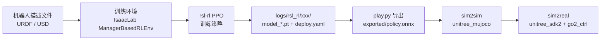

# Go2 开发指南（从看懂仓库到跑通训练 / 部署）

> 适用环境：Isaac Sim 5.1.0 + Isaac Lab 2.3.0 + rsl-rl；显存 8 GB 建议 `--num_envs 1024`。
> 本仓库默认使用 **Go2 + URDF**（`UNITREE_ROS_DIR=~/unitree_ros`，可用环境变量覆盖）。
>
> 相关文档：
> - [`GO2_TRAINING_METRICS.md`](./GO2_TRAINING_METRICS.md)：RL 任务说明、训练指标与曲线判读
> - [`GO2_CLASSICAL_GAIT.md`](./GO2_CLASSICAL_GAIT.md)：**传统步态控制路线**（MuJoCo，不依赖 Isaac/ROS2）

---

## 1. 这个仓库是什么

`unitree_rl_lab` 建立在 [IsaacLab](https://github.com/isaac-sim/IsaacLab) 之上，做的事情可以概括成一条流水线：



它**不是**从零写的 RL 库，而是：

1. 用 YAML/Python **配置文件**把 Go2 的 MDP（观测、动作、奖励、终止、事件、课程）描述出来；
2. 复用 IsaacLab 的仿真能力和 rsl-rl 的 PPO 实现来训练；
3. 提供一套 **C++ 部署框架**（`deploy/`），把训练好的 ONNX 策略以 DDS 的方式跑在真机/仿真上。

### 技术栈

| 层次 | 组件 |
|---|---|
| 仿真 | Isaac Sim 5.1 + PhysX |
| 环境框架 | Isaac Lab 2.3（Manager-Based RL） |
| RL 算法 | rsl-rl（PPO，on-policy） |
| 模型描述 | `unitree_ros` 的 URDF（推荐）或 `unitree_model` 的 USD |
| 部署 | unitree_sdk2 (DDS) + ONNX Runtime + yaml-cpp FSM |

---

## 2. 目录地图（Go2 相关）

```
unitree_rl_lab/
├── unitree_rl_lab.sh                     # 统一入口：-i 安装 / -l 列任务 / -t 训练 / -p 播放
├── scripts/
│   ├── list_envs.py                      # 列出所有已注册任务
│   └── rsl_rl/
│       ├── train.py                      # 训练入口（同时导出 deploy.yaml）
│       ├── play.py                       # 回放 + 导出 policy.onnx / policy.pt
│       └── cli_args.py                   # --load_run/--checkpoint/--resume 等
├── source/unitree_rl_lab/unitree_rl_lab/
│   ├── assets/robots/
│   │   ├── unitree.py                    # ★ 所有机器人 cfg（Go2/H1/G1…）+ unitree_ros 路径
│   │   └── unitree_actuators.py          # ★ 电机模型（PD 参数、力矩/速度限幅）
│   ├── tasks/locomotion/
│   │   ├── robots/go2/
│   │   │   ├── __init__.py               # ★ gym.register("Unitree-Go2-Velocity")
│   │   │   └── velocity_env_cfg.py       # ★★ Go2 的 MDP 全在这（场景/观测/奖励/事件…）
│   │   ├── agents/rsl_rl_ppo_cfg.py      # ★ PPO 超参与网络结构
│   │   └── mdp/                          # 自定义观测/奖励/课程/速度命令
│   └── utils/export_deploy_cfg.py        # 训练时把环境参数导出成 deploy.yaml
├── deploy/
│   ├── include/                          # C++ 版 IsaacLab（观测/动作管理器、FSM）
│   └── robots/go2/
│       ├── config/config.yaml            # ★ FSM 与 policy_dir 配置
│       ├── src/State_RLBase.cpp          # RL 状态：读 deploy.yaml + policy.onnx 输出关节角
│       └── main.cpp                      # DDS 初始化 + FSM 启动
└── logs/rsl_rl/<task>/<timestamp>/       # 训练产物（params/、exported/、model_*.pt）
```

`★` 是你 90% 时间会改的文件。

---

## 3. 五条必须理解的“配置层”

IsaacLab 的 Manager-Based 环境把 MDP 拆成若干 manager，`velocity_env_cfg.py` 就是在填这些 manager：

| 配置类 | 作用 | Go2 当前取值（摘要） |
|---|---|---|
| `RobotSceneCfg` | 机器人在哪、地形、传感器、灯光 | `num_envs=4096`，`env_spacing=2.5`；地形生成器但只启用 `MeshPlaneTerrainCfg`（平地） |
| `CommandsCfg` | 给策略的速度指令 | 初始 `vx,vy∈[-0.1,0.1]`、`wz∈[-1,1]`；上限 `vx∈[-1,1]`、`vy∈[-0.4,0.4]`、`wz∈[-1,1]` |
| `ActionsCfg` | 策略输出 → 关节目标 | `JointPositionAction`，12 个关节，`scale=0.25`，以默认站姿为偏置 |
| `ObservationsCfg` | 策略/价值网络输入 | policy 45 维（角速度3+重力投影3+指令3+关节角12+关节速度12+上次动作12）；critic 再加线速度3+关节力矩12 |
| `RewardsCfg` | 奖励塑形 | 跟踪线速度 1.5、跟踪角速度 0.75 + 一串惩罚（关节速度/加速度/力矩、足端滑移、接触不良、姿态不平…） |
| `TerminationsCfg` | 提前结束判定 | 超时、base 触地、姿态角超 0.8 rad |
| `EventCfg` | 域随机化 | 摩擦/弹性 0.3~1.2、base 质量 +(-1,3) kg、每 5~10 s 随机推一把 |
| `CurriculumCfg` | 课程学习 | `terrain_levels_vel`（地形难度）+ `lin_vel_cmd_levels`（指令范围逐步放大，从 0.1 起步） |

时间尺度：

- `sim.dt = 0.005`（物理 200 Hz）
- `decimation = 4` → **策略 50 Hz**
- `episode_length_s = 20.0`

> 记住这句话再往下看：**改环境 = 改这些 config 类；改算法 = 改 `rsl_rl_ppo_cfg.py`。**

---

## 4. Go2 从零跑通（实操）

### Step 0 · 环境检查

```bash
conda activate env_isaaclab
cd ~/unitree_rl_lab_egg
python -c "import isaaclab, unitree_rl_lab, rsl_rl; print('ok')"
nvidia-smi          # 确认驱动/显存
```

### Step 1 · 机器人模型（已配好）

当前使用 URDF 方案：

```python
# source/unitree_rl_lab/unitree_rl_lab/assets/robots/unitree.py
UNITREE_ROS_DIR = "~/unitree_ros"

UNITREE_GO2_CFG = UnitreeArticulationCfg(
    spawn=UnitreeUrdfFileCfg(
        asset_path=f"{UNITREE_ROS_DIR}/robots/go2_description/urdf/go2_description.urdf",
    ),
    ...
)
```

首次 spawn 时 IsaacLab 会把 URDF 转成 USD（约 10 秒），之后每次启动都会重新转换（缓存在 `/tmp/IsaacLab/usd_*`）。
运行时若看到 `Head_upper/Head_lower/visuals` 的 `Unresolved reference` **警告可以忽略**，那是纯显示层的问题，物理和训练不受影响。

### Step 2 · 确认任务注册

```bash
./unitree_rl_lab.sh -l | grep -i go2
# 应看到 Unitree-Go2-Velocity
```

想加新任务时：复制 `tasks/locomotion/robots/go2/` 改个名，并确保 `tasks/__init__.py` 的 `import_packages` 能扫到（它会自动递归导入，无需手动注册）。

### Step 3 · 先小规模试跑（重要）

默认 `num_envs=4096`，**8 GB 笔记本显卡基本会爆显存/极慢**。先用小规模确认能跑通：

```bash
./unitree_rl_lab.sh -t --task Unitree-Go2-Velocity --headless \
    --num_envs 512 --max_iterations 5
```

看到类似 `Iteration time: 0.5s`、`Total timesteps` 且正常退出，说明链路通了。
稳定后可试 `--num_envs 1024 / 2048`（显存不够就降，Go2 平地任务 1024 通常已能学会）。

### Step 4 · 正式训练

```bash
./unitree_rl_lab.sh -t --task Unitree-Go2-Velocity --headless --num_envs 2048
```

产物在 `logs/rsl_rl/unitree_go2_velocity/<2026-xx-xx_hh-mm-ss>/`：

```
params/env.yaml        # 环境配置快照（复现用）
params/agent.yaml      # PPO 超参快照
params/deploy.yaml     # ★ 部署用：joint_ids_map / kp / kd / default_joint_pos / action scale...
params/velocity_env_cfg.py  # 源码快照
model_0.pt, model_100.pt ...
```

断点续训：

```bash
./unitree_rl_lab.sh -t --task Unitree-Go2-Velocity --resume --load_run 2026-10-xx_hh-mm-ss
```

看曲线：

```bash
tensorboard --logdir logs/rsl_rl/unitree_go2_velocity
```

重点看 `Episode_Reward/track_lin_vel_xy`（越大越好）、`Metrics/base_velocity/error_vel_xy`（越小越好）、`Episode_Termination/base_contact`。

> 📘 任务目标、全部指标的含义、曲线判读标准、训练结束后的数据保留、异常排查，见补充文档 [`GO2_TRAINING_METRICS.md`](./GO2_TRAINING_METRICS.md)。

### Step 5 · 回放 + 导出 ONNX

```bash
# 默认取最新的 run
./unitree_rl_lab.sh -p --task Unitree-Go2-Velocity --num_envs 32
```

`play.py` 会顺便在该 run 目录下生成：

```
exported/policy.pt
exported/policy.onnx      # 部署用
```

这一步同时是**验收**：机器人能按随机指令走起来，才值得往下做 sim2sim。

### Step 6 · sim2sim（MuJoCo）

1. 修改 `~/unitree_mujoco/simulate/config.yaml`：

```yaml
robot: "go2"
domain_id: 0          # 与 main.cpp 里的 Init(0, network) 对应
interface: "lo"
use_joystick: 1       # 没有手柄设为 0
```

2. 编译部署程序（首次）：

```bash
# 依赖（首次）
sudo apt install -y libyaml-cpp-dev libboost-all-dev libeigen3-dev libspdlog-dev libfmt-dev
# unitree_sdk2（首次）
cd ~ && git clone git@github.com:unitreerobotics/unitree_sdk2.git
cd unitree_sdk2 && mkdir -p build && cd build && cmake .. -DBUILD_EXAMPLES=OFF && sudo make install

cd ~/unitree_rl_lab_egg/deploy/robots/go2
mkdir -p build && cd build && cmake .. && make -j
```

3. 启动仿真 + 控制器（两个终端）：

```bash
# 终端 A
cd ~/unitree_mujoco/simulate/build && ./unitree_mujoco

# 终端 B
cd ~/unitree_rl_lab_egg/deploy/robots/go2/build
./go2_ctrl            # 真机时加 --network eth0
```

按键流程（由 `config/config.yaml` 定义）：

| 动作 | 效果 |
|---|---|
| `L2 + A` | Passive → FixStand（站起来，kp/kd 斜坡） |
| `Start` | FixStand → Velocity（开始执行策略） |
| `LT + B` | 任意状态 → Passive（趴下） |

`policy_dir` 在 `config.yaml` 里是相对路径 `../../../logs/rsl_rl/unitree_go2_velocity`，`param::parser_policy_dir()` 会自动挑**最新且含 `exported/` 的子目录**。想固定某个模型就直接写完整 run 路径。

### Step 7 · sim2real

前提：机载控制程序已关闭、网卡名正确、策略经过了 sim2sim 验证。

```bash
./go2_ctrl --network eth0
```

上真机前务必：先从 512 环境小模型验证、务必做 `Passive` 急停演练（`LT + B`）。

---

## 5. “我想改 X，应该改哪里”

| 想改的东西 | 位置 |
|---|---|
| Go2 的关节 PD / 力矩限幅 / 电机模型 | `assets/robots/unitree.py` 中 `UNITREE_GO2_CFG.actuators` + `assets/robots/unitree_actuators.py` |
| 初始站姿 / 出生高度 | `UNITREE_GO2_CFG.init_state` |
| 速度指令范围、指令切换周期 | `velocity_env_cfg.py` → `CommandsCfg`（或在 `mdp/commands/velocity_command.py` 改采样逻辑） |
| 观测项、噪声、缩放 | `ObservationsCfg`；新项写在 `tasks/locomotion/mdp/observations.py` |
| 动作缩放 / 是否用默认偏置 | `ActionsCfg` |
| 奖励权重、加减新奖励 | `RewardsCfg`；新函数写在 `tasks/locomotion/mdp/rewards.py` |
| 提前终止条件 | `TerminationsCfg` |
| 域随机化（摩擦、质量、推力） | `EventCfg` |
| 地形（台阶/斜坡/粗糙） | `COBBLESTONE_ROAD_CFG`（被注释的子地形取消注释即可，注意 proportion 之和为 1） |
| 课程学习 | `CurriculumCfg` + `mdp/curriculums.py` |
| 并行环境数、仿真步长、episode 长度 | `RobotEnvCfg.__post_init__` |
| PPO 超参、网络结构 | `tasks/locomotion/agents/rsl_rl_ppo_cfg.py` |
| 部署侧观测/动作实现 | `deploy/include/isaaclab/envs/mdp/observations/observations.h`、`actions/joint_actions.h` |
| 部署 FSM / 按键 / 状态机 | `deploy/robots/go2/config/config.yaml`、`deploy/include/FSM/` |

> ⚠️ **最关键的坑**：训练侧的观测顺序/缩放/动作定义一旦改动，`deploy/` 里的 C++ 实现必须同步修改，否则 sim2sim 会出现“策略不动/乱抖”。`deploy.yaml` 只能自动同步 kp/kd/默认角/action scale 这类数值，**观测项的顺序和算法要人工保持一致**。

---

## 6. 学习路线（按这个顺序下手）

### 阶段 1：会用（1~2 天）
1. 读完本文件和仓库 `README.md` 的 Installation。
2. 用 `--num_envs 512 --max_iterations 5` 跑通，再用 `-p` 回放。
3. 对照 `logs/.../params/env.yaml` 与 `velocity_env_cfg.py`，理解“配置 → 运行参数”的对应关系。

### 阶段 2：会改（3~5 天）——主战场
1. 精读 `tasks/locomotion/robots/go2/velocity_env_cfg.py`（约 380 行，从上到下就是完整 MDP）。
2. 对照 IsaacLab 文档的 [Manager-Based RL](https://isaac-sim.github.io/IsaacLab/main/source/tutorials/03_envs/create_manager_rl_env.html) 与 [任务设计](https://isaac-sim.github.io/IsaacLab/main/source/tutorials/03_envs/modify_direct_rl_env.html)。
3. 做三个小实验（每个都只改一个变量，跑 300 iterations 看曲线）：
   - 删掉 `energy` 惩罚 → 观察能耗/动作幅度变化；
   - 把 `track_lin_vel_xy` 权重 1.5 → 3.0 → 观察跟踪误差与稳定性；
   - 打开 `COBBLESTONE_ROAD_CFG` 里的 `random_rough` 地形 → 观察是否学会越野。
4. 自己写一个奖励函数放进 `mdp/rewards.py` 并注册到 `RewardsCfg`。

### 阶段 3：会调（1~2 周）
1. 读 rsl-rl 的 `OnPolicyRunner` / `PPO` 实现，理解 `num_steps_per_env=24`、`num_learning_epochs=5`、adaptive KL 的作用。
2. 理解本仓库的**非对称 actor-critic**：critic 用特权信息（线速度、力矩），policy 只用可观测信息 —— 这是能否上真机的关键。
3. 训练技巧：课程学习曲线（`Curriculum/lin_vel_cmd_levels`）、随机化强度、`num_envs` 与迭代速度的权衡。

### 阶段 4：会部署（1 周）
1. 读 `utils/export_deploy_cfg.py`：搞清楚 `deploy.yaml` 里每个字段是怎么来的。
2. 读 `deploy/include/isaaclab/envs/manager_based_rl_env.h` + `observation_manager.h` + `action_manager.h`：这是 C++ 版的 manager，与 Python 侧一一对应。
3. 读 `deploy/robots/go2/src/State_RLBase.cpp`：输入是 `LowState`（IMU+关节），输出是 `LowCmd`（目标关节角）。
4. 跑 sim2sim，记录真机与仿真行为差异，再回到阶段 2 改随机化。

### 参考资源
- Isaac Lab 文档：<https://isaac-sim.github.io/IsaacLab>
- Isaac Lab 官方 velocity 任务（本仓库的“母版”）：`IsaacLab/source/isaaclab_tasks/isaaclab_tasks/manager_based/locomotion/velocity/`
- rsl-rl：<https://github.com/leggedrobotics/rsl_rl>
- unitree_ros（URDF 来源）：<https://github.com/unitreerobotics/unitree_ros>
- unitree_mujoco（sim2sim）：<https://github.com/unitreerobotics/unitree_mujoco>

---

## 7. 常见问题

| 现象 | 原因 / 处理 |
|---|---|
| `No conda environment activated` | 先 `conda activate env_isaaclab`，`unitree_rl_lab.sh` 依赖 `CONDA_PREFIX` |
| 训练刚开始就 OOM / 卡死 | 降 `--num_envs`（4096 默认值不适配 8 GB 显存），或降 `sim.physx.gpu_max_rigid_patch_count` |
| `Head_upper/Head_lower visuals Unresolved reference` | URDF 转 USD 的显示层警告，可忽略 |
| `Could not find a checkpoint` | `play.py` 需要已有训练结果；指定 `--checkpoint <path>` 或 `--load_run <run名>` |
| 训练很慢 | 确认在跑 GPU（`nvidia-smi`），`--headless`，`--num_envs` 别太小（小于 128 反而低效） |
| sim2sim 机器人不动 | 检查 `domain_id`（0）、`interface`（`lo`）、`policy_dir` 是否指向含 `exported/policy.onnx` 的 run |
| 实机抖动/发散 | 观测项与部署侧不一致、PD 参数不匹配（`deploy.yaml` 的 kp/kd）、或 sim2sim 未通过 |
| 想换回 USD 模型 | 在 `UNITREE_GO2_CFG` 中恢复 `UnitreeUsdFileCfg` 并配置 `UNITREE_MODEL_DIR` |

---

## 8. 命令速查

```bash
# 安装（可编辑模式）
./unitree_rl_lab.sh -i

# 列出任务
./unitree_rl_lab.sh -l | grep -i go2

# 试跑
./unitree_rl_lab.sh -t --task Unitree-Go2-Velocity --headless --num_envs 512 --max_iterations 5

# 正式训练（自动 headless）
./unitree_rl_lab.sh -t --task Unitree-Go2-Velocity --headless --num_envs 2048

# 续训
./unitree_rl_lab.sh -t --task Unitree-Go2-Velocity --resume --load_run 2026-10-22_21-00-00

# 回放 + 导出 onnx
./unitree_rl_lab.sh -p --task Unitree-Go2-Velocity --num_envs 32

# 曲线
tensorboard --logdir logs/rsl_rl/unitree_go2_velocity

# 部署编译
cd deploy/robots/go2 && mkdir -p build && cd build && cmake .. && make -j

# sim2sim / sim2real
cd ~/unitree_mujoco/simulate/build && ./unitree_mujoco
cd deploy/robots/go2/build && ./go2_ctrl [--network eth0]
```

---

## 9. 最小上手清单（打印出来打勾）

- [ ] `conda activate env_isaaclab` 后能 `import unitree_rl_lab`
- [ ] `./unitree_rl_lab.sh -l` 能看到 `Unitree-Go2-Velocity`
- [ ] `--num_envs 512 --max_iterations 5` 能正常结束
- [ ] 读过 `velocity_env_cfg.py`，能说出 policy 观测的 6 个 term
- [ ] 改过一个奖励权重并跑出对比曲线
- [ ] `-p` 回放能看到 Go2 行走
- [ ] 找到 `exported/policy.onnx` 与 `params/deploy.yaml`
- [ ] sim2sim 中按 `L2+A → Start` 让 Go2 走起来
